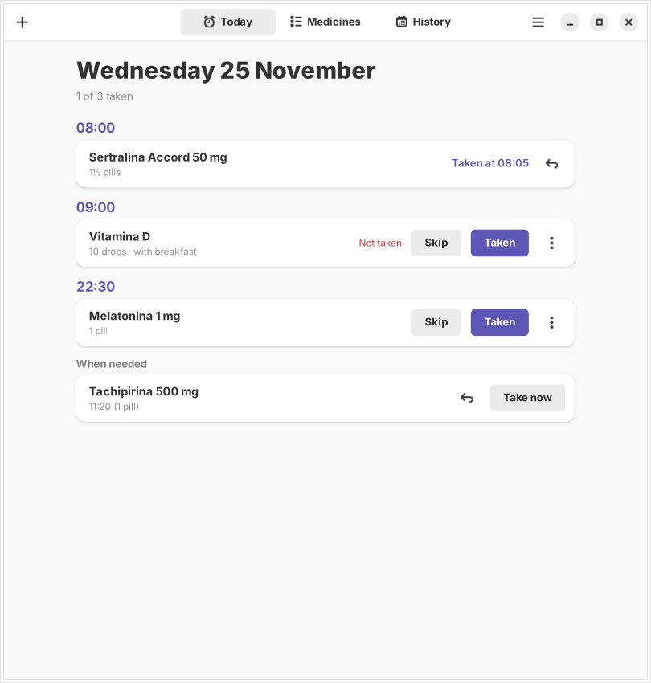
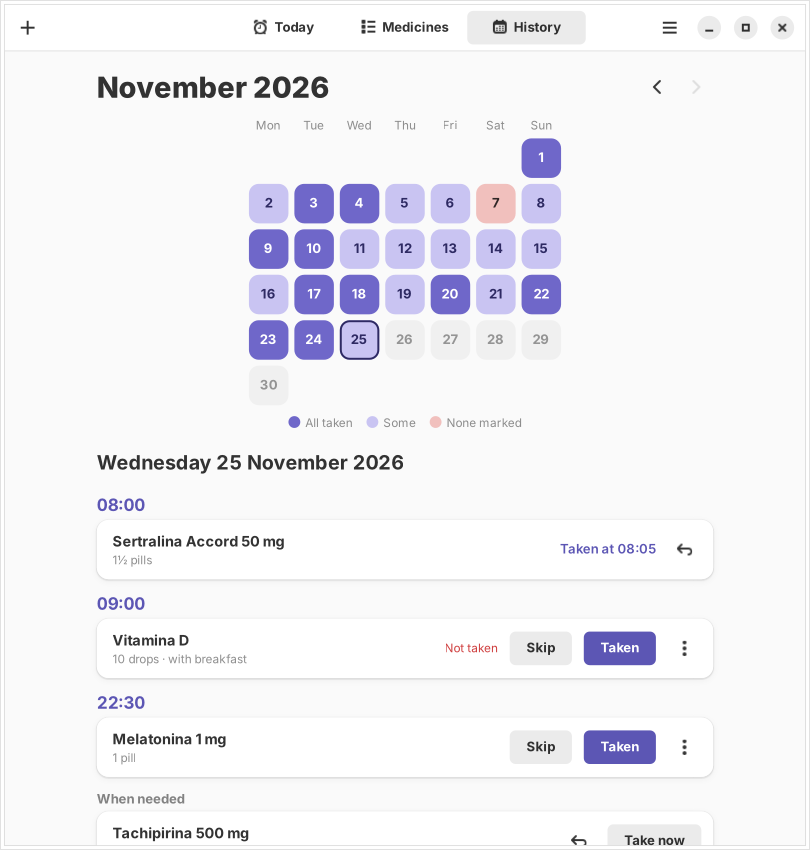

# Dose

**Your medicines, quietly.** The sister app of [Sottovoce](https://github.com/Akii-G/sottovoce).

Dose keeps the medicines you take and their schedules, reminds you when it's time, and
remembers what you took. Your data stays on your devices: the iPhone app syncs with your PC
over your home Wi-Fi, encrypted. No account, no cloud, no ads.

## What it does

- **Today**: the day's doses, by morning, afternoon, evening and night. Tap **Taken** or
  **Skip**; a dose you forgot stays visible, and you can mark it with the time you really took
  it. Medicines you take **only when needed** have a **Take now** button.
- **Medicines**: add one by searching the list of medicines authorised in Italy (name, strength
  and form fill in by themselves), or type any name. Then how much each time and when: every
  day, some days of the week, every few days, only when needed, or a course with an end date.
- **Stock**: say how many you have, and Dose counts down as you take them and tells you when
  they're running low.
- **History**: a calendar of the days you took everything, some or nothing, each day's doses,
  and every change: started, dose changed, stopped.
- **Reminders**: a notification when a dose is due, with **Taken** and **Later** buttons, and
  one more after 30 minutes if it isn't marked. **Discreet** notifications don't name the
  medicine.

Dose doesn't give medical advice and doesn't check interactions: it keeps track of what your
doctor prescribed.

## Install

**Linux (Pop!_OS, Ubuntu, Debian)**: download `dose_<version>_all.deb` from the
[releases](https://github.com/Akii-G/dose-tracker/releases), then:

    sudo apt install ./dose_1.0.1_all.deb

The reminders and the phone sync run in the background (the `dose-background` user service),
also when the window is closed.

**iPhone**: download `Dose-iPhone-<version>.ipa` and install it with a sideloading app
(AltStore, SideStore, Feather or similar). Dose isn't on the App Store.

## Sync

On the PC: ☰ → **Phone sync**, switch it on, and copy the address and the token. On the
iPhone: **Settings → Sync with your PC**, paste them, and tap **Test the connection**. After
that it syncs by itself whenever something changes. Everything is encrypted with the token
(AES-256-GCM); the token itself never crosses the network. The format is in
[docs/FORMAT.md](docs/FORMAT.md).

If the phone can't reach the PC, allow port 8766 on the PC's firewall
(`sudo ufw allow 8766/tcp`).

## Medicine list

The search uses the list of medicines authorised in Italy from
[AIFA's open data](https://www.aifa.gov.it/open-data) (CC BY 4.0), trimmed to name, strength,
form and active ingredient by `tools/build_medicines.py` and shipped inside the apps. It's
searched on your device: nothing is looked up online, so no one learns what you take.

## Languages

English and Italian.

## License

MIT. Medicine names © AIFA, CC BY 4.0.
