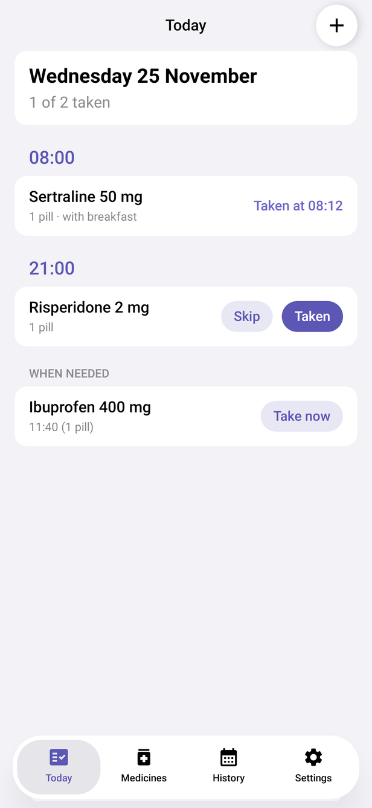
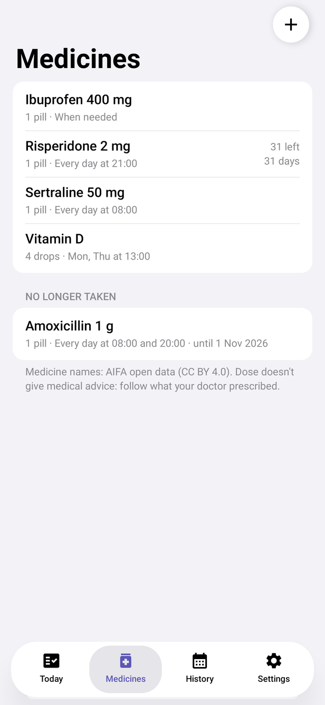
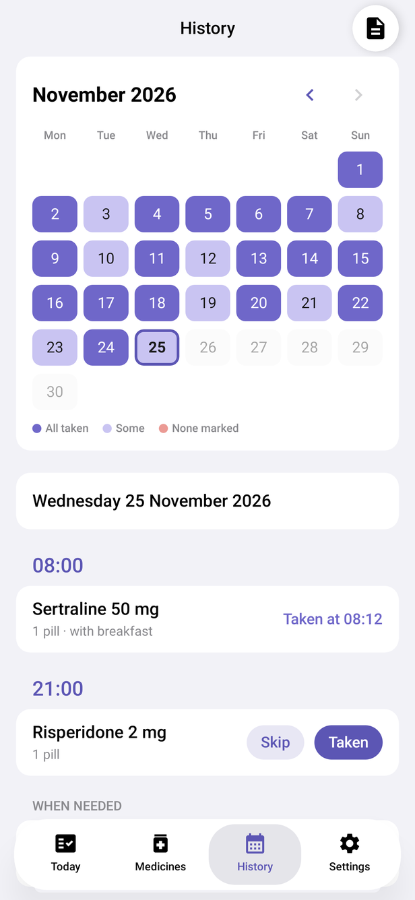
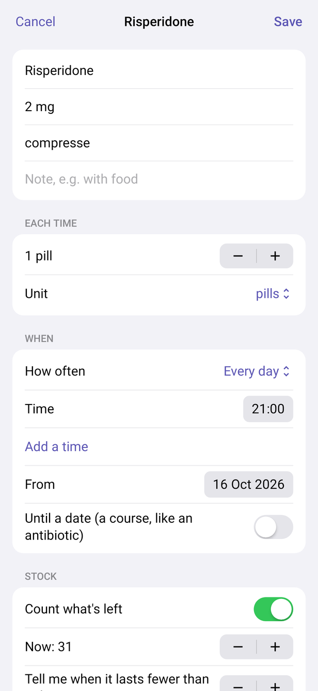

# Dose

**Your medicines, quietly.** The sister app of [Sottovoce](https://github.com/Akii-G/sottovoce).

Dose keeps the medicines you take and their schedules, reminds you when it's time, and
remembers what you took. Your data stays on your devices: the iPhone and Android apps sync
with your PC (Linux or Windows) over your home Wi-Fi, encrypted. No account, no cloud, no ads.

## What it does

- **Today**: the day's doses, grouped by time (08:00, 21:00…). Tap **Taken** or
  **Skip**; a dose you forgot stays visible, and you can mark it with the time you really took
  it. Medicines you take **only when needed** have a **Take now** button.
- **Medicines**: add one by searching the list of medicines authorised in Italy (name, strength
  and form fill in by themselves), by **scanning the barcode on the box** with the phone, or by
  typing the AIC number printed on it; or type any name. Then how much each time and when: every
  day, some days of the week, every few days, only when needed, or a course with an end date. A
  medicine can have **a different amount at each time** (1 in the morning, ½ in the evening).
- **Stock**: say how many you have, and Dose counts down as you take them and tells you when
  they're running low.
- **History**: a calendar of the days you took everything, some or nothing, each day's doses,
  and every change: started, dose changed, stopped.
- **Report for your doctor**: for the last week, two weeks, month, three months or any dates,
  each medicine's doses taken, skipped and not taken, those taken when needed and the changes,
  then the doses day by day. As a PDF to print or send, or a CSV for a spreadsheet.
- **Backup**: one file with all your medicines and doses; restore it on a new phone or PC.
- **Large text**: with the largest text sizes on the phone, rows stack instead of squeezing.
- **Reminders**: a notification when a dose is due, with **Taken** and **Later** buttons, and
  one more after 30 minutes if it isn't marked. **Discreet** notifications don't name the
  medicine.

Dose doesn't give medical advice and doesn't check interactions: it keeps track of what your
doctor prescribed.

## Install

**Linux (Pop!_OS, Ubuntu, Debian)**: download `dose_<version>_all.deb` from the
[releases](https://github.com/Akii-G/dose-tracker/releases), then:

    sudo apt install ./dose_1.2.0_all.deb

The reminders and the phone sync run in the background (the `dose-background` user service),
also when the window is closed.

**Windows 10 and 11**: download `Dose-Setup-<version>.exe` and run it. The reminders and the
phone sync run in the background from when you log in; the installer opens port 8766 for phones
on private (home) networks only.

**Android**: download `Dose-Android-<version>.apk` and open it on the phone (allow installing
from your browser or file manager when Android asks).

**iPhone**: download `Dose-iPhone-<version>.ipa` and install it with a sideloading app
(AltStore, SideStore, Feather or similar). Dose isn't on the App Store.

## Sync

On the PC: ☰ → **Phone sync**, switch it on, and copy the address and the token. On the
phone: **Settings → Sync with your PC**, paste them, and tap **Test the connection**. After
that it syncs by itself whenever something changes. Everything is encrypted with the token
(AES-256-GCM); the token itself never crosses the network. The format is in
[docs/FORMAT.md](docs/FORMAT.md).

If the phone can't reach the PC, allow port 8766 on the PC's firewall
(`sudo ufw allow 8766/tcp` on Linux; the Windows installer does it for you).

Sottovoce on the same PC reads Dose's medicines and doses for its doctor report, on Linux and on
Windows. On Android, Sottovoce can also read Dose on the same phone, once you allow it in
Sottovoce's Settings. On iPhone, without a PC: in Dose, **Settings → Share with Sottovoce** saves
one file (for example in *On My iPhone*) that Dose keeps up to date; in Sottovoce, **Settings →
Dose on this iPhone**, choose that same file.

## Medicine list

The search uses the list of medicines authorised in Italy from
[AIFA's open data](https://www.aifa.gov.it/open-data) (CC BY 4.0), trimmed to name, strength,
form and active ingredient by `tools/build_medicines.py` and shipped inside the apps. It's
searched on your device: nothing is looked up online, so no one learns what you take.

## Languages

English and Italian.

## License

MIT. Medicine names © AIFA, CC BY 4.0.
